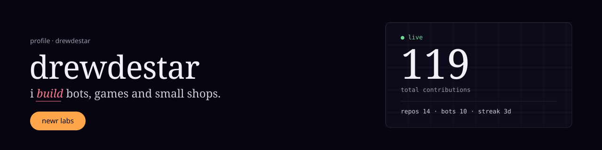

<!-- ================= LUMEN BANNER ================= -->

  

  
  

<!-- ================= INTRO ================= -->

  Hi, I'm Andrèw. I'm 16, a student in Jakarta, and I build things on the internet.
  Discord bots for my own server, a small web game, and a shop that runs on Telegram.
  This page is where that work lives.

---

<!-- ================= RIGHT NOW ================= -->
<h2 align="center">Right now</h2>

  Building the NEWR Adventure web game from zero — v6, an original design,
  not a copy of anything. 
  In the middle of olympiad season: 15 competitions across November 2026. 
  Class 10 Perhotelan 1, SMKS Paskita Global, Jakarta.

<!-- ================= GROWING ================= -->
<h2 align="center">Growing right now</h2>

  <b>NEWR Adventure</b> — a Discord RPG, and a playable web game at
  <a href="https://adventure.newrlabs.web.id">adventure.newrlabs.web.id</a>. Live, and still growing. 
  <b>NEWR LABS bots</b> — Support, AI, Music, Reminder, Social, Stats, Guardian and Clip,
  all running on my own server. 
  <b>Drèw Store</b> — a Telegram shop for premium accounts, with its own admin bot. 
  <b>newrlabs</b> — my little corner of the web, at
  <a href="https://newrlabs.my.id">newrlabs.my.id</a>.

  One stubborn piece: the game bridge runs through tunnels that rotate every ten minutes,
  so a stable address is still on my list.

<!-- ================= REPOS ================= -->
<h2 align="center">Featured repos</h2>

<table align="center">
  <tr>
    <td><a href="https://github.com/drewdestar/NEWR-Adventure-discord"><b>NEWR-Adventure-discord</b></a></td>
    <td>The Discord RPG — 51 slash commands, shared world with the web game</td>
  </tr>
  <tr>
    <td><a href="https://github.com/drewdestar/NEWR-Adventure-Admin-discord"><b>NEWR-Adventure-Admin-discord</b></a></td>
    <td>Its admin companion — events, economy and player tools</td>
  </tr>
  <tr>
    <td><a href="https://github.com/drewdestar/NEWR-Support-discord"><b>NEWR-Support-discord</b></a></td>
    <td>Server support bot — tickets, applications, verify flow</td>
  </tr>
  <tr>
    <td><a href="https://github.com/drewdestar/NEWR-AI-discord"><b>NEWR-AI-discord</b></a></td>
    <td>The server's AI bot — answers, memory, and a shared brain</td>
  </tr>
  <tr>
    <td><a href="https://github.com/drewdestar/NEWR-Music-discord"><b>NEWR-Music-discord</b></a></td>
    <td>Music for the server, streaming through Lavalink</td>
  </tr>
  <tr>
    <td><a href="https://github.com/drewdestar/newr-bridge-url"><b>newr-bridge-url</b></a></td>
    <td>The one file that always knows where the game bridge lives</td>
  </tr>
</table>

<!-- ================= ADVENTURE SPOTLIGHT ================= -->
<h2 align="center">NEWR Adventure — the game</h2>

  My RPG. One character, everywhere: Discord, Telegram, and the web share the same world. 
  Battles and raids, guilds and guild wars, pets, jobs, crafting, a casino, and a story that keeps going. 
  Play it on <a href="https://discord.gg/vZU3KzEh6a">Discord</a>, in the browser at
  <a href="https://adventure.newrlabs.web.id">adventure.newrlabs.web.id</a>,
  or on Telegram at <a href="https://t.me/NEWRAdventureBot">@NEWRAdventureBot</a>.

<!-- ================= STATS ================= -->
<h2 align="center">Numbers, honestly</h2>

  

<!-- ================= OLYMPIADS ================= -->
<h2 align="center">Olympiad season</h2>

  15 competitions registered for November 2026 — Bahasa Indonesia and Bahasa Inggris,
  all free, all online. Nearest exams: Sunday 8 Nov, with five in one day.
  The season is the reason the commit graph has been quiet some weeks.

<!-- ================= STACK ================= -->
<h2 align="center">Tools I reach for</h2>

  
  
  
  
  
  

<!-- ================= LEARNING ================= -->
<h2 align="center">Learning right now</h2>

  Python and Discord.py in production, on bots people actually use. 
  JavaScript and the browser, by building the Adventure web game. 
  English — olympiad prep, one competition at a time.

<!-- ================= FIND ME ================= -->
<h2 align="center">Find me everywhere</h2>

  
  
  
  
  

  <b>NEWR LABS</b> is my Discord server — 140 members, home to all the bots and the game.
  That's where everything above happens.

<!-- ================= FOOTER ================= -->

  <i>measured to the point.</i>

